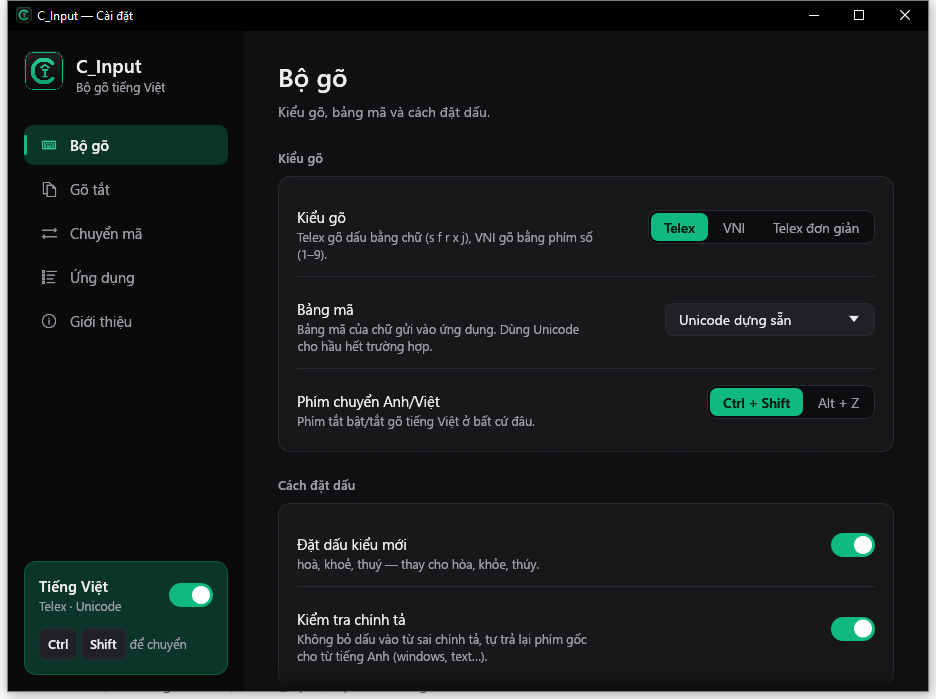

# C_Input — Bộ gõ tiếng Việt cho Windows

Bộ gõ tiếng Việt viết bằng Rust, thuộc dòng sản phẩm C. Chạy hoàn toàn trên máy, không cần mạng
(trừ tính năng Dịch AI tuỳ chọn, mặc định tắt).



## Tải về

Tải `C_Input.exe` ở trang [Releases](https://github.com/giacongnguyen94-cmyk/C_Input/releases/latest), đặt vào thư mục
bất kỳ rồi chạy (không cần cài đặt). Yêu cầu Windows 10/11, 64-bit.

- File chưa được ký số: lần đầu chạy Windows SmartScreen có thể cảnh báo → "More info" → "Run anyway".
- Tắt UniKey / bộ gõ khác trước khi dùng: hai bộ gõ chạy cùng lúc sẽ cùng sửa một chữ.
- Cấu hình lưu ở `%APPDATA%\C_Input`. Muốn gỡ: thoát C_Input ở menu khay, xoá file exe và thư mục đó.

## Tính năng

- **Kiểu gõ:** Telex, VNI, Telex đơn giản, VIQR (`Vie^.t` → Việt) và **tự định nghĩa** (gán phím cho từng chức năng,
  đọc/ghi file `keymap.txt` của UniKey). Gõ dấu tự do (`tiengs` → tiếng) hoặc tắt để dấu mũ/móc phải gõ ngay sau chữ;
  bấm lặp để bỏ dấu (`ass` → as).
- **Phím Esc khôi phục:** bấm Esc ngay sau một từ để đổi qua lại giữa tiếng Việt và đúng các phím đã gõ
  (`tieengs` → tiếng → Esc → tieengs); cũng hoàn tác gõ tắt.
- **Đặt dấu** kiểu mới (hoà, thuý) hoặc kiểu cũ (hòa, thúy).
- **Kiểm tra chính tả:** không bỏ dấu vào từ sai, tự trả lại phím gốc cho từ tiếng Anh (`windows`, `text`, `user`).
- **Từ tiếng Anh giữ nguyên:** gõ đúng một từ trong danh sách (`test`, `error`, `password`, `data`, kể cả dạng
  `-ed/-ing`: `passed`, `using`) thì giữ tiếng Anh dù Telex ra được âm tiết tiếng Việt. Muốn "tét" thì gõ `tets`;
  bỏ dấu bằng phím lặp vẫn như cũ (`tesst` → test). Danh sách có sẵn ở `crates/cinput-core/src/english_words.txt`
  (có test bảo đảm không trùng cách gõ chuẩn của từ tiếng Việt có thật); thêm từ riêng ở `%APPDATA%\C_Input\english.txt`.
  Bật/tắt riêng, không phụ thuộc "Kiểm tra chính tả".
- **Dịch AI theo câu (Google Gemini, mặc định tắt):** gõ xong một câu (`.` `?` `!` + dấu cách) thì câu đó được thay
  bằng bản dịch sang ngôn ngữ đã chọn; dịch chạy nền, gõ tiếp câu sau không phải chờ. Chỉ thay khi câu còn nguyên
  chỗ cũ (bấm chuột, mũi tên, đổi cửa sổ, sửa vào câu → bỏ qua). Không dịch khi Enter, trong ô mật khẩu và ứng dụng
  luôn gõ tiếng Anh. API key lưu mã hoá DPAPI (chỉ tài khoản Windows của bạn giải mã được), gửi trong header HTTPS.
  Bật/tắt nhanh ở menu khay. Khi tắt, C_Input không gửi gì lên mạng.
- **Dịch đoạn bôi đen (mặc định bật, cần API key Gemini):** bôi đen chữ ở bất kỳ đâu (tin nhắn đến, trang web) rồi
  bấm **Ctrl+C hai lần** → cửa sổ nhỏ cạnh con trỏ hiện bản dịch sang ngôn ngữ đọc (mặc định tiếng Việt); đổi ngôn
  ngữ ngay trong cửa sổ để dịch lại, chép bản dịch, Esc để đóng. Văn bản gốc không bị sửa. Cũng có ở menu khay.
- **Tự viết hoa đầu câu** và **tự tắt tiếng Việt trong ô mật khẩu** (Win32 + UI Automation).
- **Xoá lùi về từ trước:** gõ `a` + dấu cách, xoá dấu cách rồi gõ `s` → "á" (sửa tiếp được từ vừa gõ, nhớ tối đa 32 từ).
  Bấm chuột, phím mũi tên, Enter, Tab hay đổi cửa sổ thì quên các từ trước để không sửa nhầm chỗ khác.
- **Bảng mã khi gõ:** Unicode dựng sẵn / tổ hợp, TCVN3 (ABC), VNI Windows, VIQR, VISCII, VPS, BK HCM 1/2,
  Vietware F/X, Windows CP1258, NCR thập phân / thập lục phân.
- **Gửi chữ qua clipboard** cho phần mềm cũ không nhận Unicode từ bộ gõ (dán rồi trả lại clipboard của bạn).
- **Gõ tắt** (tương thích file UniKey `từ:nội dung`, nhập/xuất file), tự viết hoa theo chữ gõ: `vn` → việt nam, `VN` → VIỆT NAM.
- **Chuyển mã** văn bản / clipboard giữa 16 bảng mã (thêm UTF-8 Literal để sửa chữ bị lỗi font, C String `\uXXXX`),
  bỏ dấu, đổi hoa/thường.
- **Tự kiểm tra bản mới** trên GitHub mỗi ngày; cập nhật trong Cài đặt → Giới thiệu (kiểm tra SHA-256 trước khi thay file).
- **Giao diện tiếng Việt / English.**
- **Theo ứng dụng:** nhớ chế độ Anh/Việt cho từng ứng dụng, danh sách ứng dụng luôn gõ tiếng Anh.
- Biểu tượng khay hệ thống (bấm để bật/tắt, chuột phải để mở menu), khởi động cùng Windows.
- **Ổn định:** tự cài lại hook bàn phím nếu Windows gỡ mất (kiểm tra mỗi giây); sửa lỗi gợi ý tự động
  ở thanh địa chỉ trình duyệt / Excel (gõ "goos" ra "gố", không còn "goố"); tự nhận ra ứng dụng chạy quyền
  Admin mà C_Input không có quyền (tạm ngừng bỏ dấu thay vì làm mất chữ) và cho chạy lại với quyền Admin.

| Phím tắt | Chức năng |
|---|---|
| `Ctrl + Shift` (hoặc `Alt + Z`) | Bật/tắt tiếng Việt |
| `Ctrl + Shift + F5` | Mở cài đặt |
| `Ctrl + Shift + F9` | Chuyển mã clipboard |
| `Ctrl + C` hai lần | Dịch đoạn đang bôi đen |

## Cấu trúc

```
crates/cinput-core     lõi gõ (không phụ thuộc Windows): engine, Telex/VNI, chính tả, đặt dấu, gõ tắt
crates/cinput-charset  chuyển bảng mã (bảng TCVN3/VNI sinh từ vnconv/data.cpp của UniKey 3.62 bằng tools/gen_tables.py)
app/                   C_Input.exe: service.rs (hook bàn phím, khay hệ thống), settings.rs + ui.rs (giao diện egui)
branding/              logo phương án B "Mũ ^" (concepts.py vẽ, make_logo.py xuất PNG + ICO cho exe, khay, giao diện)
tools/                 gen_tables.py: sinh lại bảng mã (cần mã nguồn UniKey 3.62, không kèm trong repo)
```

`C_Input.exe` chạy bộ gõ nền. `C_Input.exe --settings` mở cửa sổ cài đặt (một tiến trình riêng). Hai tiến trình trao đổi qua file cấu hình `%APPDATA%\C_Input\config.toml` và một thông điệp cửa sổ.

## Build

```bash
cargo test --release
```

Bộ test gồm 656.352 ca trên 27.816 âm tiết (Telex/VNI, đặt dấu cũ/mới, gõ chuẩn và gõ dấu tự do,
chữ thường/Hoa đầu/HOA HẾT). Giới hạn đã biết của Telex: vần "oo" (xoong) phải gõ "ooo".

Chạy thử với phím giả lập: đặt biến môi trường `CINPUT_TEST_INJECTED=1` trước khi chạy `C_Input.exe` —
bộ gõ khi đó nhận cả phím do script gửi và ghi nhật ký vào `%TEMP%\cinput_test.log`. Không dùng khi chạy thật.

```bash
cargo build --release
```

File chạy: `target/release/C_Input.exe` (một file duy nhất, có sẵn icon). Bản phát hành:
`powershell -ExecutionPolicy Bypass -File toolsuild_release.ps1` — build không nhúng đường dẫn thư mục của máy build
(tên người dùng, ổ đĩa) vào file chạy, kèm SHA256SUMS.txt. Tạo lại logo/icon: `python branding/make_logo.py`.

## Giấy phép và ghi công

C_Input phát hành theo [GNU GPL v3.0 hoặc mới hơn](LICENSE).

- Bảng mã TCVN3 (ABC) và VNI Windows được trích từ mã nguồn **UniKey 3.62** của **Phạm Kim Long**
  (GPL v2 hoặc mới hơn, <https://www.unikey.org>). Phần lõi gõ, giao diện và các tính năng khác được viết mới bằng Rust.
- Font giao diện (Segoe UI) và biểu tượng (Segoe MDL2 Assets) được đọc từ Windows lúc chạy, không kèm trong repo.
